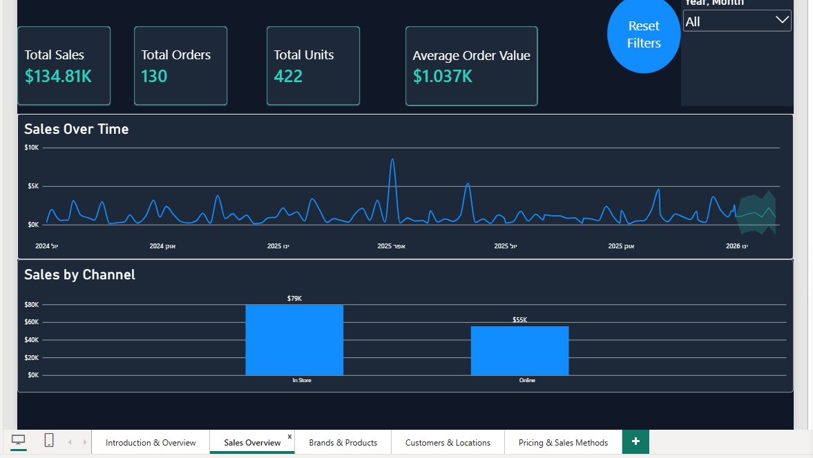
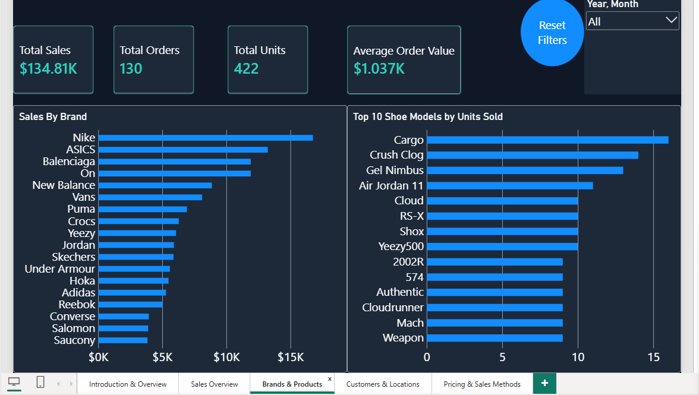
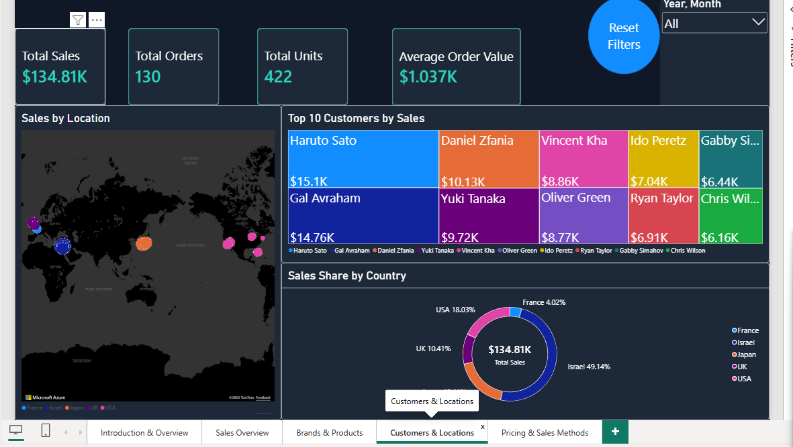
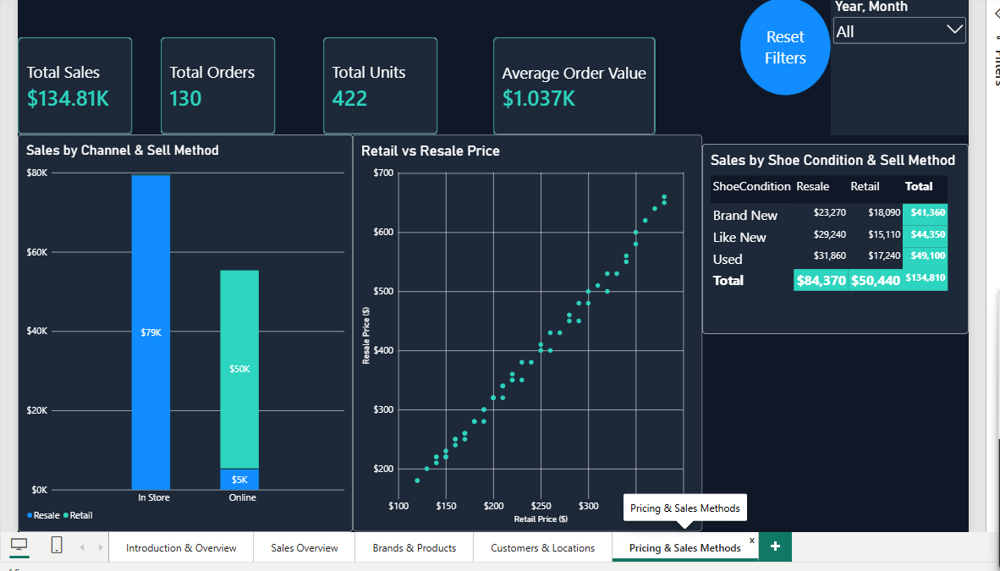
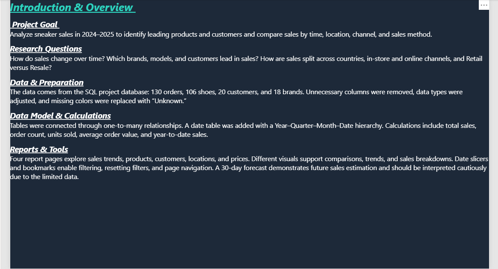

# Sneakers Sales Dashboard — Power BI

An interactive Power BI project analyzing sneaker sales by time, brand, product, customer, location, and sales channel.

## Project overview

This project builds on my earlier SQL database project. I adapted the database to meet the Power BI course requirements, prepared the data, and created a relational model and interactive report pages.

**Tools & skills:** Power BI, Power Query, DAX, SQL Server, T-SQL, data preparation, data modeling, and data visualization.

## Report pages

- **Sales Overview** — total sales, orders, units sold, average order value, sales trends, and channel comparisons.
- **Brands & Products** — sales by brand and units sold by shoe model.
- **Customers & Locations** — customer sales and geographic comparisons using a map, treemap, and donut chart.
- **Pricing & Sales Methods** — retail versus resale prices, sales channels, sales methods, and shoe condition.
- **Introduction & Overview** — project goals, data preparation, model, and report features.

Date slicers, tooltips, and bookmarks support interactive exploration. The report also includes year-to-date sales and a forecasting example.

## Dashboard previews

Download `Sneakers_PowerBI.pbix` and open it in Power BI Desktop to explore the filters and interactive report.

### Sales Overview

### Brands & Products

### Customers & Locations

### Pricing & Sales Methods

### Introduction & Overview

## Dataset and SQL preparation

The project uses fictional sneaker sales data for educational purposes. The original database contains Brands, Customers, Shoes, and Orders.

Two SQL scripts document different stages of the project: the original database creation and the subsequent adaptations for the Power BI assignment. These adaptations include copying the tables into a dedicated database, introducing missing color values, varying order quantities, and adding primary and foreign keys to the copied tables. Missing colors were subsequently handled during data preparation.

The CSV is the original source dataset; it does not include the later SQL adjustments. The adaptation script records the preparation steps and requires the appropriate database context when executed.

## Files

- **images/** — screenshots of the report pages.
- **Sneakers_PowerBI.pbix** — Power BI report and data model.
- **Sneaker sales project.sql** — original SQL database creation and loading script.
- **SQLQueryPowerBI.sql** — SQL preparation and modifications for the Power BI project requirements.
- **Sneakers sales project.csv** — original source dataset.

Open the `.pbix` file in Power BI Desktop to explore the interactive report.
